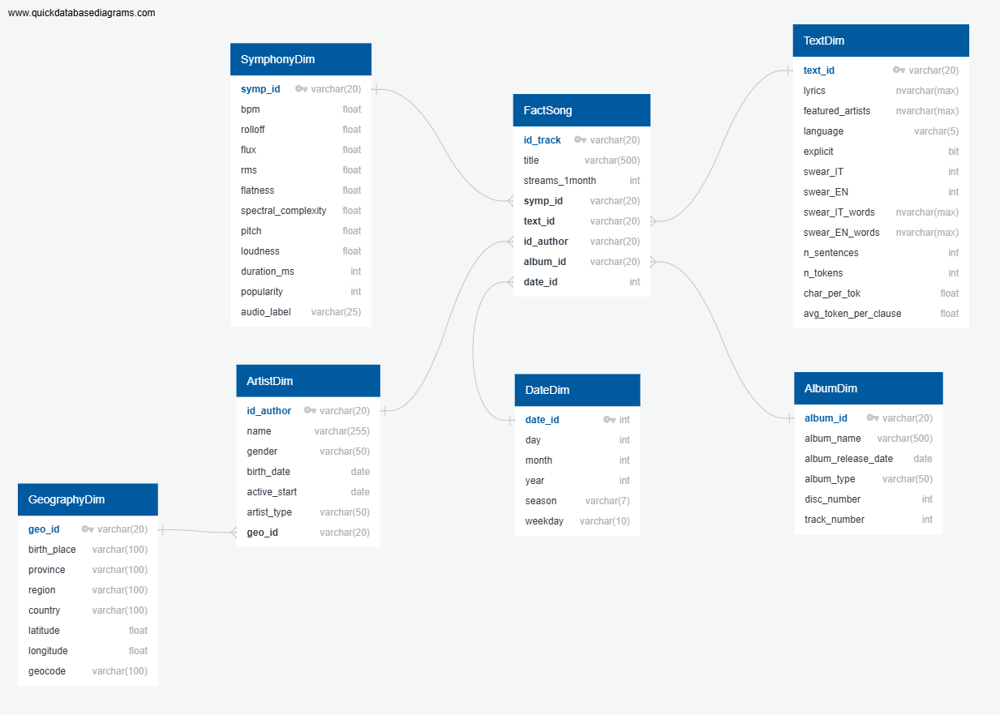
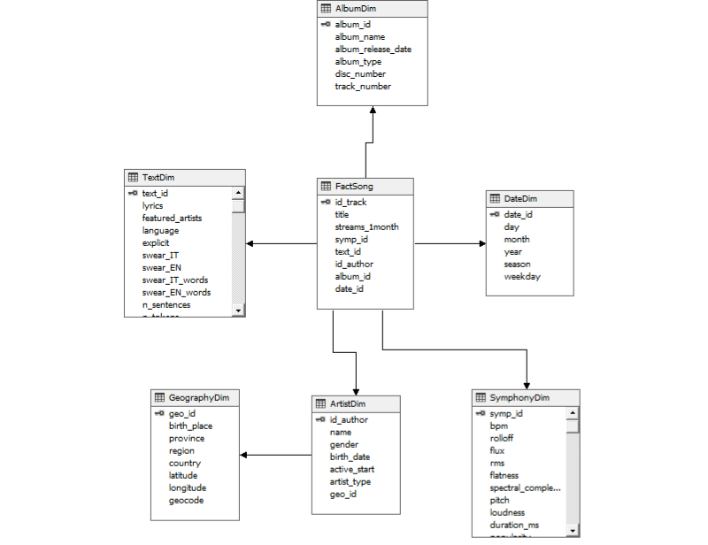
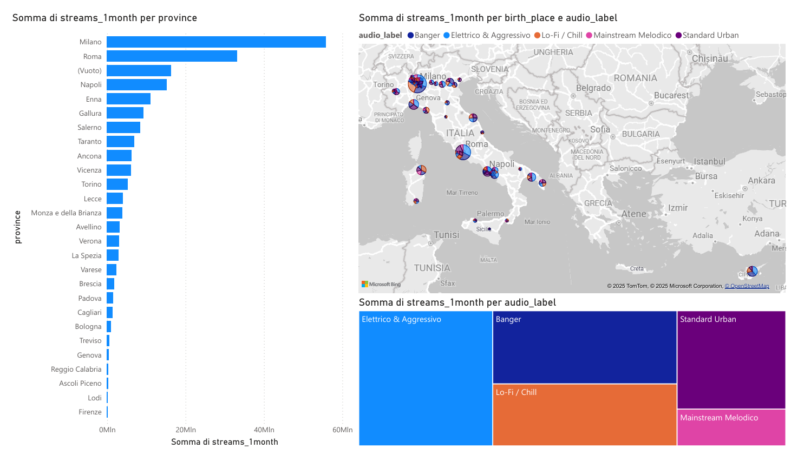
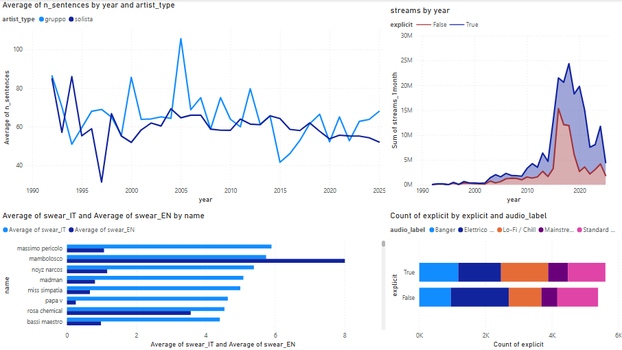
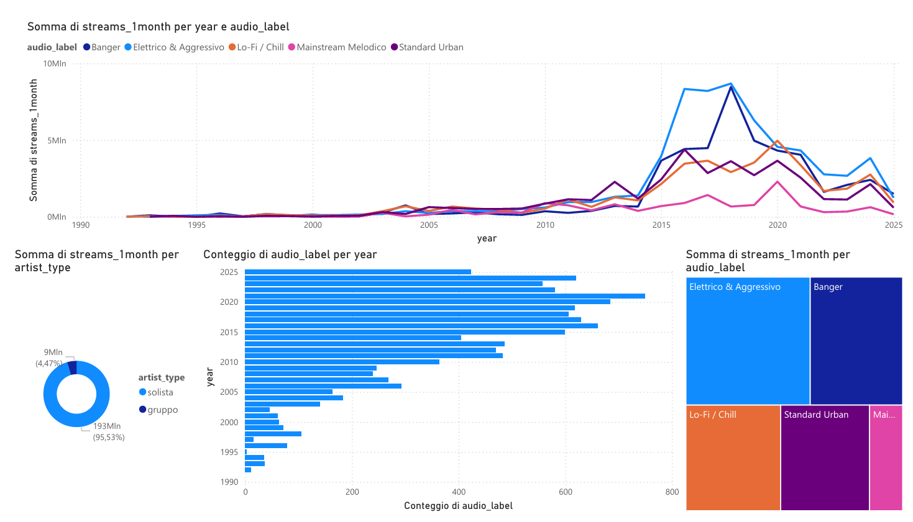

# Decision Support System for a Music Streaming Platform

End-to-end Business Intelligence project developed for the **Decision Support Systems Laboratory** (Master in Data Science and Business Informatics, University of Pisa, A.Y. 2025/26).

Starting from two raw datasets (songs and artists of the Italian music scene), the project builds a complete decision support pipeline: data understanding and cleaning in Python, a data warehouse on SQL Server, ETL and analytical queries with SSIS, an OLAP cube queried with MDX, and interactive dashboards in Power BI.

📄 Full report: [`LDS_project_Group06_EN.pdf`](LDS_project_Group06_EN.pdf) (English) · [`LDS_project_Group06.pdf`](LDS_project_Group06.pdf) (Italian)

## Tech stack

| Area | Tools |
|---|---|
| Data understanding, cleaning, profiling | Python (standard library, `pygeohash`, `geopy`, `langdetect`), pandas and scikit-learn for exploration and clustering |
| Data warehouse | Microsoft SQL Server, `pyodbc` |
| ETL and analytical queries | SQL Server Integration Services (SSIS) |
| OLAP | SQL Server Analysis Services (multidimensional cube), MDX in SSMS |
| Dashboards | Power BI |

## Data

- `tracks.json`: 11,166 songs with lyrics features, audio features, album and release information, and the number of streams one month after release
- `artists.xml`: 104 artists with gender, birth date and place, years of activity and coordinates

After cleaning, the data warehouse contains **11,007 tracks**, 104 artists, 47 birth places, 3,054 albums and 2,429 release dates (1992–2025).

> The datasets were provided by the course instructors for educational purposes.

## Data warehouse

Star-like schema with the fact table **FactSong** (grain: one track, measure: `streams_1month`) and six dimensions: DateDim, ArtistDim → GeographyDim, AlbumDim, TextDim (lyrics features) and SymphonyDim (audio features and song category).



The OLAP cube (Assignment 14) is built on the same tables, excluding AlbumDim, with `streams_1month` as its measure and hierarchies on the date and geography dimensions:



## Repository structure

```
├── 1_python/                 Assignments 1–6
│   ├── A1 _data_undestanding.ipynb   exploratory analysis
│   ├── A2_artists.py                 cleaning of artists.xml (manual fixes, geocoding, geohash)
│   ├── A2_tracks.py                  cleaning of tracks.json (dates, language, featured artists, imputation, new IDs)
│   ├── A3_clustering.ipynb           song profiling with k-means on audio features
│   ├── A4_data_preparation.py        creation of the DW tables on SQL Server
│   ├── A5_creating_dimensions.py     split of the data into one CSV per DW table
│   ├── A6_data_upload.py             batch upload of the CSVs into the DW
│   └── db_config.py                  connection settings (read from .env)
├── 2_ssis/                   Assignments 7–13 (SSIS project: A7.dtsx … A13.dtsx)
│   └── output/               CSV results of the analytical queries
├── 3_olap/
│   ├── MultidimensionalProject3/     Analysis Services project (cube, Assignment 14)
│   └── mdx/                          MDX queries, Assignments 15–19
├── 4_dashboard/dashboard.pbix        Power BI dashboards, Assignments 20–22
├── data/
│   ├── raw/                  original datasets
│   └── processed/            cleaned data (artisti.csv, tracks_clean.csv)
├── dimensions/               one CSV per DW table (output of A5, input of A6)
└── docs/img/                 images used in this README
```

## Pipeline

```
data/raw/artists.xml ──► A2_artists.py ──► data/processed/artisti.csv ───────────────────┐
                                                                                           ├─► A5 ──► dimensions/*.csv ──► A6 ──► SQL Server DW
data/raw/tracks.json ──► A2_tracks.py ──► tracks_cleaned_A2.csv ──► A3 (adds audio_label) ─┘          (tables created by A4)
                                                                    └─► data/processed/tracks_clean.csv
SQL Server DW ──► SSIS (A7–A13) ──► 2_ssis/output/*.csv
SQL Server DW ──► SSAS cube (A14) ──► MDX queries (A15–A19) and Power BI dashboards (A20–A22)
```

## Assignments

| # | Topic | Where |
|---|---|---|
| 1–3 | Data understanding, cleaning, song profiling | `1_python/` |
| 4–6 | DW schema, data preparation, upload with Python | `1_python/` |
| 7 | Load 30% of the data into `*_SSIS` tables (percentage sampling + lookups) | `2_ssis/A7.dtsx` |
| 8 | For each year, artists ordered by number of songs | `2_ssis/A8.dtsx` |
| 9 | Summer–winter score per region (songs and streams) | `2_ssis/A9.dtsx` |
| 10 | Streams of a category in a region vs. the other regions | `2_ssis/A10.dtsx` |
| 11 | Trending percentage and trending factor per artist (main and featured) | `2_ssis/A11.dtsx` |
| 12 | Lyrics/rhythm features vs. average streams | `2_ssis/A12.dtsx` |
| 13 | Albums vs. singles performance by region (record label perspective) | `2_ssis/A13.dtsx` |
| 14 | OLAP cube with date and geography hierarchies | `3_olap/MultidimensionalProject3/` |
| 15–18 | Monthly streams by region, weighted artist share, YoY growth by category, seasonal growth | `3_olap/mdx/` |
| 19 | Relative Popularity Index (regional specialisation of each category) | `3_olap/mdx/Assignment 19.mdx` |
| 20–22 | Dashboards: streams by birth place and category, lyrics analysis, category trends over time | `4_dashboard/` |

## Dashboards

| Streams by birth place and category | Lyrics analysis | Category trends over time |
|---|---|---|
|  |  |  |

## Known limitations

This is a course project and was delivered as is; while reviewing it afterwards, we noted the following points:

- **Song profiling**: k-means was trained on unscaled audio features, so the clusters are driven mainly by `rolloff` and `pitch`; the category names were assigned qualitatively.
- **Geography**: some birth places could not be mapped to a province/region, and foreign-born artists were assigned country "Italia"; these artists appear with an empty region in the regional analyses.
- **Featured artists** are stored as free text: a bridge table (track–artist–role) would make Assignments 11 and 16 more robust than text matching.
- **Assignment 11** uses fixed thresholds (+15% / −50% of the artist's average, 6,000 streams) instead of the ±1 standard deviation rule of the assignment.
- **Assignment 18**: the delivered query does not iterate over years, so the previous-season average is empty; a corrected version is in `3_olap/mdx/Assignment 18 (corrected).mdx`.

## Authors

Elisa Lucarelli · Riccardo Ranieri · Pietro Gagliardi

Instructors: Prof. Anna Monreale, Dott. Cristiano Landi — University of Pisa
